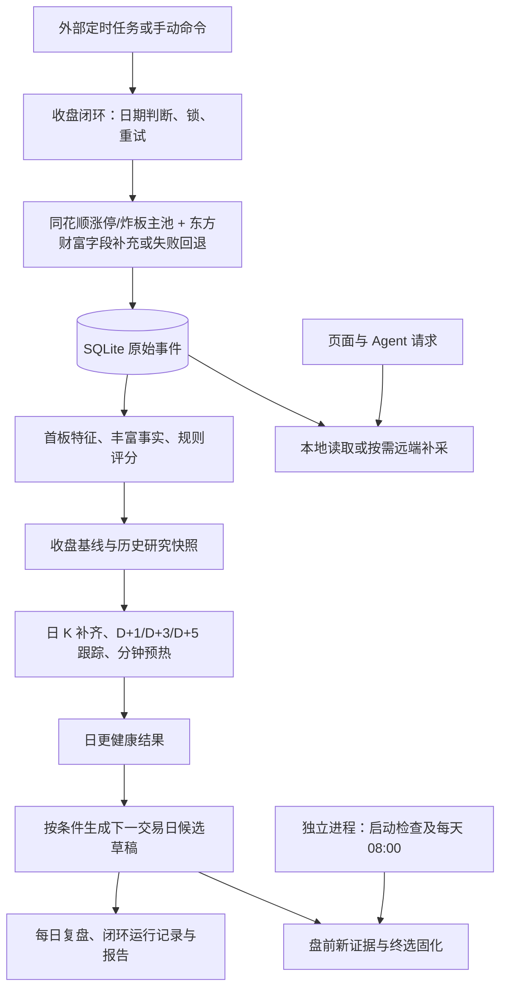

# 数据采集

本文说明 LimitUpLab 当前代码如何取得数据、收盘后如何同步、哪些数据会留在本地，以及这些数据有哪些使用边界。

核对日期：**2026-10-16**。在原核对起点 Git HEAD `6c6a991` 的基础上，补充核对本次“涨停与炸板池同花顺优先”变更。依据是采集器、服务、Repository、数据库建表代码和调度脚本；没有把旧 README、配置注释或已有历史文件直接当作当前功能。本文描述代码默认行为，不代表本机或服务器已经安装定时任务，也不代表上游接口在任意历史日期都可用。

## 1. 数据链路总览

项目采用“远端采集 → 结构化模型 → SQLite 持久化 → 确定性特征与统计 → 页面及 Agent 使用”的主链路，但不是所有数据都按同一个频率更新。

| 链路 | 触发入口 | 主要工作 | 结果位置 |
| --- | --- | --- | --- |
| 收盘日更 | `run_daily_close_loop.py`，手动或外部定时任务 | 导入当日涨停/炸板、重建特征、丰富首板事实、保存评分批次、补齐追踪行情和结果、生成复盘 | SQLite、日更报告 JSON |
| 盘前候选快照 | `run_recommendation_refresh_loop.py` 独立进程 | 在已入库收盘基础上更新行情、个股新闻、财务、龙虎榜、人气，按时间契约固化结果 | SQLite、候选刷新报告 JSON |
| 查询时补采 | 个股详情、市场页面、Agent 工具 | 缺失的日 K/分钟 K、个股资讯，以及指数、板块、跌停、热股等按需查询 | 部分写 SQLite，部分仅进程内缓存 |
| 启动时检查 | `start_local.cmd` 或 `start_dev_detached.py` 分别调用 `dev_check.py --ensure-data` | 检查本地日期，尝试更新数据并准备候选草稿；两个启动器的失败处理和 worker 启动行为不同 | SQLite、启动检查报告 JSON |
| 历史研究补采 | `sync_first_board_history.py`、单日导入脚本 | 对本地历史重建特征，或显式请求有限历史池、K 线与 Outcome | SQLite |



**采集范围是围绕涨停研究对象展开的。** 当前没有每天下载全 A 股全部历史 K 线、全量三大财务报表、所有板块成分和全市场分钟行情的统一任务。

主要入口：[收盘闭环](backend/scripts/run_daily_close_loop.py)、[日更流水线](backend/scripts/update_daily_data.py)、[盘前刷新进程](backend/scripts/run_recommendation_refresh_loop.py)、[本地启动器](scripts/start_dev_detached.py)。

## 2. 实际接入的数据源

### 2.1 涨停池、炸板池与涨停原因

统一入口为 [preferred_limit_up_collector.py](backend/app/collectors/preferred_limit_up_collector.py)，日更、历史同步和单日导入均采用同花顺优先策略：

| 数据 | 实际调用 | 处理方式 |
| --- | --- | --- |
| 收盘封住涨停的股票 | 同花顺 CLI `special limit-up-pool`，遍历全部页 | 决定股票集合、名称、连板高度和涨停原因，标记 `closed_limit=True` |
| 炸板股票 | 同花顺 CLI `special limit-break-pool`，遍历全部页 | 决定股票集合，优先使用可用的炸板次数、成交额、换手率，标记 `closed_limit=False` |
| 必填字段补充与失败回退 | AKShare 东方财富 `stock_zt_pool_em`、`stock_zt_pool_zbgc_em` | 同池同代码补首次/最后封板时间、封板/炸板次数、成交额、换手率和行业；同花顺请求失败时，该池整体回退东方财富 |

两池独立选择来源。同花顺成功时，东方财富独有股票不追加进集合；同花顺成功返回空池时，不再查询该池东方财富。跨池重复股票保留闭板身份，即使它因必填字段缺失未入库，也不能降为炸板。炸板记录的 `board_height` 固定为 `1`，不把滚动“涨停统计”当作连续涨停高度。

补充字段使用严格校验，不以 0 或午夜时间替代缺失评分输入。同花顺成功但东方财富补充失败时，该池无法构建的事件跳过；只有部分同代码匹配时，仅跳过未匹配股票并报告缺口。同花顺请求失败、分页不完整等异常才触发该池整体回退；回退成功记录警告，可保持完整状态。

采集结果不是单纯一个列表，而是 `LimitUpCollectionResult`：

- `ok`：两池完整且存在事件，包括成功回退的情况。
- `empty`：两池完整，但没有事件。
- `partial`：存在未补齐的池或股票，仍有有效事件或完整的池。
- `error`：存在采集错误，且既无有效事件也无完整的池。

同时返回 `data_fresh`、`source_errors`、`payload`、`pool_sources`、`source_warnings` 和可复用的同花顺闭板池快照。日更报告使用 `collection_status / collection_data_fresh / collection_sources / collection_errors`；原 `akshare_status / akshare_data_fresh / akshare_source_errors` 保留为兼容别名，不再表示只采 AKShare。降级原因进入 `warnings`，事件表本身不归档原始响应或逐字段来源。

正常日更复用本次全分页闭板池快照统计数量、合并原因，不再额外请求第 1 页核对。入库闭板数与快照 `total` 的差值用于发现跳过等情况；原因规范化见 [limit_up_reason.py](backend/app/services/limit_up_reason.py)。全分页入口校验页码、总数、重复代码和截断标记；响应显式提供 `trade_date` 时才校验日期。快照中的 `trade_date` 仍是请求日期回显，接口 `timestamp` 不能直接当作市场交易日。

收盘闭环传入 `--replace-date` 对应行为，只有 `ok / empty` 才替换目标日旧集合；`partial / error` 保留旧行并仅更新本次有效事件。因此不完整同步时，本地可能暂存旧集合中的股票，须结合报告判断。

### 2.2 日 K 线和当日 OHLC

[market_data_provider.py](backend/app/services/market_data_provider.py) 是日线的统一优先级入口：

1. 历史日 K：同花顺 CLI `market history --adjust none`。
2. 同花顺失败或无有效日线：AKShare 腾讯历史 `stock_zh_a_hist_tx(adjust="")`。
3. 需要补目标日 OHLC：优先同花顺 `market snapshot`；缺失股票或整体失败时回退腾讯 `qt.gtimg.cn` 报价。

当前使用**不复权**价格。统一模型包含交易日、开高低收、成交量、成交额、来源，以及可用时的涨跌幅。同花顺返回的成交量从“股”除以 100 转成项目使用的“手”。不复权价格在除权除息等场景可能出现断点，不能把跨日价格跳变一律解释为普通涨跌。

历史请求从目标日向前扩展 `max(days × 3, 15)` 个自然日，再取最近所需根数。日线来源标签包括：

- `hithink-finance.market.history.none`
- `hithink-finance.market.snapshot`
- `akshare.stock_zh_a_hist_tx`
- `tencent.qt.gtimg.cn`

当日快照有日期校验：同花顺检查组装快照时间转换后的上海日期，腾讯检查报价携带的交易日期；不是将当前报价任意写成历史日期。相关实现见 [stock_kline_collector.py](backend/app/collectors/stock_kline_collector.py)。

### 2.3 分钟 K 线

分钟采集优先使用新浪 `CN_MarketDataService.getKLineData`；新浪返回空数据或发生代码捕获的解析、网络异常时，回退 AKShare 东方财富 `stock_zh_a_hist_pre_min_em`，按所需周期聚合。接口接受 1～60 分钟周期，并按请求交易日过滤。

新浪接口取得的是有上限的最近数据，代码将 `datalen` 限制到最多 1970；东方财富回退提取 `09:30–15:00`。因此不能承诺补到任意久远日期的分钟线。

[stock_kline.py](backend/app/services/stock_kline.py) 的 `load_stock_intraday_bars()` 先查 SQLite；同股票、日期、周期已有数据就直接返回，否则采集后写库。多日接口最多接受 10 个交易日，并逐日返回 `complete / missing / error`，保留部分成功结果。

当前分钟入库调用将 `source` 固定写成 `sina-minute-direct`，即使底层用了东方财富回退；这项来源标签尚不能精确区分回退路径。

### 2.4 首板丰富信息：龙虎榜、人气、上市日期、技术事实

相关实现：[first_board_enrichment_collector.py](backend/app/collectors/first_board_enrichment_collector.py)、[first_board_enrichment.py](backend/app/services/first_board_enrichment.py)。

| 数据 | 来源及顺序 | 实际使用方式 |
| --- | --- | --- |
| 龙虎榜 | 同花顺 `special dragon-tiger --board-type all` → AKShare 东方财富 `stock_lhb_detail_em` | 提取上榜、买入额、卖出额、净买额、原因、来源；同股多记录按规则选取 |
| 当前人气 | 同花顺 `special hot-stock --period day` → 东方财富当前 Top100 | 保存排名、排名变化、采集时间和来源 |
| 上市日期 | 东方财富 `stock_xgsglb_em(symbol="全部股票")`，缺失候选再取巨潮 `stock_profile_cninfo` | 用于上市时长等过滤和风险事实 |
| 技术事实 | 上述统一日 K 源；同日市场/板块环境另由本地事件提供 | 计算量比、位置、均线排列、阶段涨幅，以及近 20/60 日疑似涨停次数 |

丰富信息采集面向当日符合条件的封死首板：成交额至少 1 亿元，排除 ST、N/C 开头新股标记，以及北交所、科创板等代码范围；不是给全市场每只股票建立丰富信息档案。候选通常拉取截至目标日最近 125 根日 K，再计算所需窗口。

其中近 20/60 日涨停次数由相邻日 K 收盘涨幅阈值估算：创业板使用 19.5%，其他股票使用 9.5%；不是逐日核验涨停池后的精确次数，也没有“历史涨停间隔”这一采集字段。

人气采集器返回的是**调用时的当前榜单**。历史日期补跑虽然把 enrichment 归在那个交易日，仍会保留实际 `popularity_snapshot_at`；当前实现不能重建任意历史日期当时的人气。历史研究需要据此识别时间错配。

`data_missing` 记录 K 线不足、上市日期缺失、流通市值缺失、历史窗口不足、人气缺失等问题。同花顺龙虎榜路径的流通市值字段可能为 `None`，不能只看到“龙虎榜调用成功”就认定所有评分输入完整。

龙虎榜页面与 Agent 直接工具的调用链另有区别：[dragon_tiger_review.py](backend/app/services/dragon_tiger_review.py) 直接取同花顺并使用 300 秒缓存，还可以把迟到的龙虎榜事实合并进已有 enrichment；并非所有龙虎榜入口都采用同一条“同花顺失败后回东财”的链路。

### 2.5 指数、板块、跌停与其他按需行情

| 类别 | 实际来源 | 当前触发及缓存 |
| --- | --- | --- |
| 上证、深成、创业板指数 | 腾讯历史及同日报价 → 东方财富指数日线 → 新浪指数日线 | 页面/工具按需获取；快照及趋势缓存 15 分钟；指定日期时要求结果末日匹配 |
| 行业行情 | 同花顺行业概览/历史 → 东方财富行业概览/历史 | 快照缓存 5 分钟，历史缓存 15 分钟 |
| 概念行情 | 当前快照来自东方财富；历史为东方财富 → 同花顺 | 当前快照没有同花顺回退；历史查询不借用当前领涨股等字段冒充历史值 |
| 板块成分及个股比较 | 同花顺 `index catalog`、`index constituents`、`market snapshot`，再结合日 K | Agent 按需解析目录、取成分、筛选有限对象比较 |
| 跌停池 | AKShare 东方财富 `stock_zt_pool_dtgc_em` | 按需；按日期缓存 10 分钟；不在收盘主链中作为全量持久化事件池 |
| 热股榜 | 同花顺 `special hot-stock` 或东方财富当前 Top100 | Agent 按需；`auto` 且请求数量大于 30 时选东财，否则选同花顺（上限 30）；可显式选源，不是日更全量落库 |

指数、板块、跌停等上述缓存主要存在于 Python 进程内，重启后需要重新获取。已有采集方法也不等于已启用每日任务：例如同花顺适配器中存在全市场快照与指数快照方法，但核对时没有生产调用点支撑“每天全市场同步”的说法。

来源：[market_index_collector.py](backend/app/collectors/market_index_collector.py)、[sector_collector.py](backend/app/collectors/sector_collector.py)、[sector_stock_ranking.py](backend/app/services/sector_stock_ranking.py)、[limit_down_collector.py](backend/app/collectors/limit_down_collector.py)、[Agent 工具](backend/app/agents/tools.py)。

### 2.6 财务、个股资讯、财经快讯与公网搜索

| 数据 | 实际获取方式 | 持久化与限制 |
| --- | --- | --- |
| 季度利润表 | 同花顺 `financials income --period quarterly --limit 6` | 候选证据提取最近利润表摘要、报告期、发布日期、营收、净利润、归母净利润、EPS 等，嵌入候选快照；缓存复用窗口 24 小时。没有独立的三大报表全量同步 |
| 个股资讯 | AKShare `stock_news_em`，底层东方财富 | 文章及同步状态写 SQLite；成功采集后 10 分钟内复用；远端失败可返回旧缓存并标记 `stale`、缺失原因 |
| 财经快讯 | 东方财富 `getFastNewsList` 与同花顺 `tapp/news/push/stock` 并行聚合 | 去重、时间窗过滤、分类、相关度排序；常规结果缓存 5 分钟 |
| 公网搜索 | 自动依次尝试 360 网页、360 新闻、Bing、DuckDuckGo；新闻查询优先 360 新闻 | 最多 8 条标题/链接/摘要，缓存 10 分钟；属于补充文本证据，不是结构化行情数据库 |

个股资讯服务默认近 7 天、最多 10 条，内部范围上限是 30 天和 20 条；候选快照刷新每股默认只取近 7 天的 3 条。请求窗口表示过滤范围，不保证上游能够提供窗口内所有历史文章。

财经页面有两个入口：

- `/api/market/news/latest`：每个源只取一页，供首页快速显示；使用主库同目录的 `finance_news_latest.json`。5 分钟内视为新鲜，旧快照可先返回并后台更新；最多接受距采集时间 7 天的快照，失败重试间隔 30 秒。这是旧结果兜底期限，不是“近 7 天新闻全量归档”。
- `/api/market/news`：查询最近 24 小时，最大候选条数 2000，再按页展示。深扫最多东方财富 24 页、同花顺 72 页，遇到时间边界等条件提前停止；结果以进程内缓存为主。

默认 Agent profile 为 `v1_close_review`。当前启用集合已经包括财经新闻、个股新闻、热股榜、板块等工具；明确延后的是 `remote_limit_up_pool` 和 `web_search`，后者需要 `extended`。因此 profile 名称不能用来推断“所有 Agent 工具都只读本地数据库”。

来源：[stock_news.py](backend/app/services/stock_news.py)、[finance_news.py](backend/app/services/finance_news.py)、[finance_news_latest.py](backend/app/services/finance_news_latest.py)、[web_search.py](backend/app/services/web_search.py)、[recommendation_intelligence.py](backend/app/services/recommendation_intelligence.py)。

### 2.7 同花顺接入形式与网络超时

项目的 [HithinkFinanceCollector](backend/app/collectors/hithink_finance_collector.py) 是 CLI 子进程适配器。调用参数统一带 `--source remote` 和 `--format json`，解析 JSON envelope；本项目主存储是 SQLite，不能因为安装了 hithink-finance 就推断应用在读它的 DuckDB。

CLI 路径可用 `LIMITUPLAB_HITHINK_FINANCE_CLI` 指定，否则从 PATH 查找。认证由 CLI 登录状态或部署环境提供；示例文件只应放变量名和占位值。

| 配置项 | 代码默认值 | 约束对象 |
| --- | --- | --- |
| `LIMITUPLAB_HITHINK_TIMEOUT_SECONDS` | 15 秒 | 同花顺 CLI 调用 |
| `LIMITUPLAB_AKSHARE_POOL_TIMEOUT_SECONDS` | 60 秒 | 每次涨停/炸板池调用 |
| `LIMITUPLAB_AKSHARE_KLINE_TIMEOUT_SECONDS` | 60 秒 | AKShare K 线调用 |
| `LIMITUPLAB_MARKET_INDEX_TIMEOUT_SECONDS` | 10 秒 | 指数来源完整批次 |
| `LIMITUPLAB_TRADING_CALENDAR_TIMEOUT_SECONDS` | 8 秒 | 交易日历批次 |

涨停池、K 线等部分远端调用使用可终止的隔离进程，超时包含进程启动、采集和序列化；并非项目中每一种网络调用都共享同样的隔离方式。多处采集使用 `without_proxy()` 暂时清除并恢复进程代理环境，避免国内接口被无效代理阻塞。收盘脚本还会准备显式代理或探测可用本地代理。

实现：[process_timeout.py](backend/app/collectors/process_timeout.py)、[network.py](backend/app/collectors/network.py)、[config.py](backend/app/config.py)。

## 3. 每天收盘后具体怎样同步

### 3.1 日期判断、并发控制与重跑

推荐日常入口是 `backend/scripts/run_daily_close_loop.py`，它包裹 `run_daily_update()`，补上日期判断、互斥锁、重试、运行记录和最终报告。

1. 通过 `daily_close_loop.lock` 排除并发。锁默认超过 6 小时才按过期锁清理；已有有效锁时跳过。
2. 使用 `Asia/Shanghai` 时间，**15:30** 作为当日数据窗口门槛。未指定日期时，15:30 前向前寻找已结束交易日，之后可以选当天。
3. 通过 AKShare `tool_trade_date_hist_sina` 获取真实交易日历，按最近 45 个自然日窗口解析目标日期；日历采集器缓存 1 小时。日历失败时，收盘闭环使用工作日回退并记录 `weekday-fallback` 警告。
4. 显式指定尚未到窗口的日期或非交易日，未加 `--force` 时直接跳过。未指定日期的周末/节假日运行会解析最近已收盘交易日，不是无条件跳过：该日未成功完成时仍可能补跑。
5. 如果该目标日期的最近运行记录为 `success` 且未加 `--force`，直接跳过；否则创建新的 `daily_pipeline_runs` 记录。

`--force` 是强制重新执行和放宽日期门槛的参数，不是“把历史补采变成真实当时预测”的开关。

### 3.2 单次日更的执行顺序

以下是 [run_daily_update()](backend/scripts/update_daily_data.py) 的实际顺序。

| 步骤 | 具体行为 | 范围/默认值 |
| --- | --- | --- |
| 1. 导入事件 | 同花顺两池全分页优先；东方财富补必填字段或按池回退；复用闭板池快照合并原因、记录来源并写入事件 | 仅目标交易日；不完整时保留旧行 |
| 2. 重读本地事件 | 后续特征和追踪统一使用已经持久化的事件 | 如果目标日没有事件，生成健康结果并提前返回 |
| 3. 重建首板特征 | 从事件历史计算 `first_board_features` | 默认最近 60 个**已有本地事件日期**，不是自动补采 60 天原始行情 |
| 4. 更新首板丰富事实 | 日 K、技术事实、上市日期、龙虎榜、当前人气及缺失标记 | 目标日符合丰富信息筛选条件的首板 |
| 5. 规则评分与快照 | 生成首板评级并保留目标数；近期历史用 `historical_backtest`，满足同日时点要求才写 `live` 收盘基线；采集 `partial / error` 时暂缓目标日两类快照，其他历史日期仍可处理 | 默认 Top10；近期评分日期窗口为最多 6 个本地交易日 |
| 6. 补齐 Top10 跟踪 | 查已保存的规范预测批次，补日 K 并更新 Outcome | 最近 6 个本地交易日，并把最近至少 20 个日期窗口内未完成病例加入重试；闭环默认最多处理 80 个需远端补齐的追踪病例 |
| 7. 补齐涨停后观察池行情 | 对最近涨停对象填充连续行情，供涨停后形态研究使用 | 最近 7 个本地事件日期、目标 20 根日 K；默认最多 120 个股票级历史采集调用；仅在更新目标是本地最新日期时执行 |
| 8. 预热分钟缓存 | 调用分钟服务，将当日数据存入 SQLite | 仅目标日为本地最新日期时执行；当日事件池股票，排除北交所代码；1 分钟周期，默认 6 个并发；包含炸板股票，不只是 Top10 |
| 9. 汇总健康状态 | 汇总事件、特征、丰富事实、追踪和行情缺口 | 返回 `DailyUpdateReport` |

内部日更管线完成后，收盘包装器在同日基线具备条件时还会调用候选证据服务，生成下一交易日的草稿，并校验它使用的 `relay_base_date` 确实是本次收盘日。随后构建每日复盘快照，记录整体运行结果。

常规收盘导入会传入 `replace_date=True`，但只有基础池状态为 `ok / empty` 才删除该日旧事件后写入；`partial / error` 不先清空旧数据。其他日期的原始事件不会因为这一选项被清除。

`update_daily_data.py` 单独运行时默认追踪病例补采预算是 60；收盘包装器显式传入 80。每个需补采病例最多有 2 次历史采集尝试，此外还有批量当日快照与底层来源回退；这些预算不是底层 HTTP 请求总数上限。观察池会请求最多 35 根历史日 K，以核验所需 20 日窗口及底层来源一致性。

### 3.3 D+1 到 D+5 是怎样形成的

这些数据不是 LLM 预测出的未来价格，而是后续交易日真实日 K 到达后，确定性代码重新计算的历史结果。

- `stock_daily_bars` 保存涨停基准日及后续交易日的 OHLC 等行情。
- `first_board_outcomes` 保存以涨停日收盘或次日开盘为基准的 D+1、D+3 区间表现、回撤、是否进二板，以及 `next_day_ready / three_day_ready / outcome_ready`。
- D+5 路径完整性依赖基准日加后续五个交易日的日 K；不是 `first_board_outcomes` 中另存一套完整的五日分钟路径。
- 未到期窗口、到期但缺 K 线、已有完整结果需要区分；健康报告会比较 expected 与 ready。

追踪补齐和当前完整性检查使用本地 `limit_up_events` 的日期集合确定预期日期。它不是每次都独立向交易所重新查询所有历史交易日；如果本地原始事件缺整天，会影响这一日期基准。观察池其他查询也有使用本地日 K 日期并集的实现，应按对应 Query Contract 理解。

来源：[first_board_features.py](backend/app/services/first_board_features.py)、[outcome_completeness.py](backend/app/services/outcome_completeness.py)、[post_limit.py](backend/app/services/post_limit.py)。

### 3.4 什么情况下算成功

收盘包装器默认最多尝试 3 次数据管线及候选草稿刷新，失败或关键项不完整时按 20 秒、40 秒间隔重试。它检查：

- 基础涨停/炸板采集是否 `partial / error`，目标日原始事件和特征是否可用。
- 同日应保存的 live Top10 基线是否已保存。
- 追踪 Top10、涨停后观察池的日 K 是否仍有缺口。
- 已到期的 D+1、D+3、D+5 结果/路径是否齐全。
- 每日复盘快照是否生成成功。

每日复盘生成在上述重试循环之后单独尝试一次；生成失败会进入 `partial`，并不随数据管线自动再试 3 次。

最终状态为 `success / partial / error / skipped`；正常完成或跳过退出码为 0，错误为 1，部分完成为 2。原始采集 `partial / error` 时，收盘闭环也不刷新下一交易日候选草稿。成功的来源回退、丰富事实中的部分缺失、分钟预热失败等可能只形成警告，因此 **`success` 不等于所有可选字段均完整**。

每次终态会写 SQLite 运行记录及最新报告；`partial / error` 另写告警 JSON，后续非失败终态会移除告警文件。已经成功或已有锁而直接跳过的分支，不一定新建报告，排查时要同时看执行输出与报告时间。

## 4. 盘前刷新与收盘同步的关系

[run_recommendation_refresh_loop.py](backend/scripts/run_recommendation_refresh_loop.py) 是独立的常驻进程，当前执行逻辑是：启动先协调一次持久化状态，此后每天 **08:00（Asia/Shanghai）** 唤醒。不是 FastAPI 内置定时任务。

候选服务基于已入库的收盘数据，查询候选行情、近 7 天个股新闻、最近季度利润表、龙虎榜和当前人气；默认财务摘要在 24 小时内复用。新的目标交易日必须经过真实交易日历确认；这里日历不可用时保存未确认草稿并报错重试，不沿用收盘闭环的工作日回退来固化终选。

当前时间契约 `prediction-time-v2` 允许在目标交易日 **08:00 至 09:30 之前**固化盘前终选；09:30 以后未完成则进入 `missed_cutoff`，不再用开盘后的新证据补算盘前结果。已经存在的有效终选直接复用。`prediction-time-v1` 的 09:00 是兼容旧记录的时间契约，不是当前 worker 的调度时刻。

`LIMITUPLAB_RECOMMENDATION_REFRESH_MINUTES` 及 `--interval-minutes` 仍存在；当前服务默认值为 1440，示例 `.env` 中仍写 30。该值被传给服务/响应，但 worker 的下一次唤醒由 `_seconds_until_next_premarket_refresh()` 固定计算到下一次 08:00，因此示例注释“每 30 分钟刷新”不能作为当前行为依据。

`GET /api/agents/recommendation-intelligence` 读取可展示的持久化快照；浏览器刷新这个接口不会自动运行整条收盘或盘前采集流程。

来源：[候选证据服务](backend/app/services/recommendation_intelligence.py)、[时间契约](backend/app/services/prediction_time.py)、[候选快照 Repository](backend/app/repositories/recommendation_intelligence_repository.py)。

## 5. 外部任务怎样安排每天同步

### 5.1 Windows

[daily_close_loop_task.ps1](scripts/daily_close_loop_task.ps1) 提供安装、状态和卸载三种模式，默认任务名 `LimitUpLab-DailyCloseLoop`，默认周一至周五 16:00。动作使用 `backend/.venv/Scripts/python.exe` 执行收盘脚本并传 `--trigger scheduled`。

任务设置包括错过后尽快执行、忽略重复实例、执行时限 3 小时、失败后间隔 10 分钟最多重启 2 次。Principal 是当前用户、`Interactive`、有限权限；不是无人登录也必然运行的系统服务。触发器依赖 Windows 本机时区，脚本没有替系统修改时区。

以下命令从项目根目录运行，用于操作部署配置，本文编写时没有执行安装：

```powershell
# 查看是否已安装，以及上次/下次运行信息
.\scripts\daily_close_loop_task.ps1 -Mode Status

# 安装或更新工作日 16:00 任务
.\scripts\daily_close_loop_task.ps1 -Mode Install -RunAt "16:00"
```

### 5.2 Docker / Linux

[docker-compose.yml](docker-compose.yml) 中：

- `backend` 是 API 服务。
- `recommendation-refresh` 是常驻盘前刷新进程。
- `daily-update` 属于 `jobs` profile，是一次性收盘任务；仅启动普通 Compose 服务不会自动每天执行它。
- 上述相关容器共享 `limituplab-data` 卷，主库路径设为 `/app/data/limituplab.sqlite`。

[deploy/cron/limituplab-daily](deploy/cron/limituplab-daily) 提供工作日 16:00 的 cron 模板，要求宿主机采用上海时区，调用部署后的 `job.py daily-update`。`deploy/job.py` 在部署锁保护下启动任务容器，日更默认外层超时 3600 秒，并负责确认容器停止、保存日志等。

仓库中的 cron 文件、PowerShell 安装器和 Compose 服务定义是部署能力；是否已经安装并持续运行，需要检查对应机器的任务状态。

### 5.3 本地启动检查

两个本地启动入口相互独立：

- [start_local.cmd](scripts/start_local.cmd) 直接运行 `dev_check.py --ensure-data`；检查失败则中止启动，成功后启动前后端窗口。它不调用 detached 启动器，也不启动候选刷新 worker。
- [start_dev_detached.py](scripts/start_dev_detached.py) 默认也执行上述检查，可通过 `--skip-data-check` 跳过；检查失败仍继续启动前后端，并补启独立候选刷新 worker。它不会安装每天 16:00 的 Windows 任务。

`dev_check.py` 的预期日期使用工作日加 15:30 门槛规则，没有在这里核验节假日日历；这与完整收盘入口的日期解析不同。

直接执行 `uvicorn app.main:app` 只启动 API；[main.py](backend/app/main.py) 中没有日更 scheduler 或启动时全量采集逻辑。启动检查也不是收盘包装器的同义词：它直接调用 `run_daily_update()`，不因此自动产生同一套闭环运行记录、重试和每日复盘流程。

## 6. 本地会保存哪些数据

### 6.1 主数据库与路径

默认主库为 `backend/data/limituplab.sqlite`，由 `LIMITUPLAB_DATABASE_PATH` 覆盖。相对覆盖路径按进程工作目录解释，跨命令/部署时宜使用明确绝对路径。当前 schema 版本为 **12**，初始化通过迁移函数和 `PRAGMA user_version` 管理。

默认启用 WAL，因此目录中可能同时存在 `.sqlite-wal` 和 `.sqlite-shm`；它们是 SQLite 的运行文件，不应按照“空文件”或“临时后缀”随意删除。连接同时启用外键、5 秒 busy timeout、有界锁重试和 WAL checkpoint。

API、收盘入口和盘前 worker 使用配置加载器：已有进程环境变量优先，然后读取 `backend/.env`、根目录 `.env`；`LIMITUPLAB_ENV_FILE` 可以指定单一配置文件。单日简易导入、历史同步等脚本没有统一调用同一个配置加载入口，不能假定任何脚本都会自动读取 `.env`；必要时在调用它们前显式设置数据库路径等进程环境变量。

来源：[database.py](backend/app/database.py)、[config.py](backend/app/config.py)。

### 6.2 原始行情与可重新计算的研究数据

| 表 | 保存内容 | 写入/更新语义 |
| --- | --- | --- |
| `limit_up_events` | 涨停及炸板事件、基础行情和原因等字段 | `(trade_date, symbol)` 唯一；按日期导入/upsert；完整重采可先替换当日 |
| `stock_daily_bars` | 个股日 OHLC、量额、来源、可用涨跌幅、时间 | `(symbol, trade_date)` 唯一，upsert；不同时并存同一日多个来源版本 |
| `stock_intraday_bars` | 股票、日期、周期、分钟时间、OHLC/量额、来源 | 同股票/日期/周期的一批数据整体替换；查询优先复用已有批次 |
| `first_board_features` | 从事件历史计算的首板、板块、市场环境等特征 | `(trade_date, symbol)` 唯一，可重算更新，带特征版本 |
| `first_board_enrichment_snapshots` | K 线技术事实、上市日期、龙虎榜、人气、缺失项及来源时间 | `(trade_date, symbol)` 唯一，可更新；名称含 snapshot 不意味着它不可变 |
| `first_board_outcomes` | 首板后 D+1/D+3 表现、回撤、进二板、准备状态及版本 | `(base_trade_date, symbol)` 唯一，随后续行情补齐更新 |
| `stock_news_items` | 文章标题、摘要、发布时间、URL、来源、相关度和抓取时间 | 稳定文章 ID 去重/upsert |
| `stock_news_sync_state` | 每股票/来源的尝试时间、成功时间、错误 | `(symbol, source)` 更新，用于缓存新鲜度判断 |

主要实现：[事件 Repository](backend/app/repositories/limit_up_repository.py)、[首板及行情 Repository](backend/app/repositories/first_board_repository.py)、[资讯 Repository](backend/app/repositories/stock_news_repository.py)。

项目保存的是结构化后的结果，而不是所有上游请求响应的逐条原始副本。评分中的 Facts JSON 可以追溯当时使用的结构化输入，但不能据此推断保留了完整原始网页、CLI 全量响应或逐笔行情。

`limit_up_events` 没有独立的 `source`、`data_missing_json` 列；原始采集的 `concept` 初始为空，同花顺原因随后合并进这个字段，它不等于股票的全部概念板块归属。来源状态主要留在采集报告；日 K、增强快照和预测记录分别保存各自的来源、缺口或时点元数据。

### 6.3 评分、候选、复盘与审计记录

| 表 | 用途与关键边界 |
| --- | --- |
| `agent_predictions` | 代码、日期、分数、评级、置信度、版本、`prediction_source`、`data_as_of`、Facts/原因/风险/时间来源元数据；唯一键含日期、股票、评分版本、预测来源，普通冲突不覆盖 |
| `agent_live_prediction_snapshots` | 按基准交易日保存规范 live 批次，包括整个快照 JSON、条数、hash、时间；日常重跑不会随意重排覆盖 |
| `prediction_snapshot_archive` | 合法盘前终选替代收盘基线前，归档旧批次和旧预测行 |
| `recommendation_prediction_finals` | 按目标交易日保存已经校验并固化的终选响应；已有终选不重复生成 |
| `recommendation_intelligence_current` | 当前候选证据快照，固定 `slot=1` 覆盖更新，包含行情、新闻、财务、状态等 |
| `recommendation_intelligence_changes` | 追加候选关键字段的变化记录 |
| `recommendation_intelligence_snapshots` | 特定情况下保留旧响应，例如原来有条目而新批为空，或兼容退役条目；不是每次刷新全量追加一份 |
| `daily_review_snapshots` | 每个 `as_of_date` 的复盘输入/结论快照；普通冲突不覆盖 |
| `daily_pipeline_runs` | 日更运行 ID、目标日、触发来源、状态、尝试次数、报告、错误、开始/结束时间 |
| `prediction_time_audits` | 预测时间边界审计记录 |
| `scoring_policies`、`scoring_policy_runs` | Champion/Challenger 策略版本、状态、参数及优化评估运行记录 |

收盘基线和盘前终选并非“永不发生任何替换”的同一层记录。当前允许经过时间与证据校验的 `premarket_final` 在事务中取代 `close_baseline`，并先归档旧记录；已有盘前终选不能用普通刷新再次替换。历史补采以 `historical_backtest` 保存，不应混入严格前向结果。

来源：[first_board_repository.py](backend/app/repositories/first_board_repository.py)、[recommendation_intelligence_repository.py](backend/app/repositories/recommendation_intelligence_repository.py)、[review_snapshot_repository.py](backend/app/repositories/review_snapshot_repository.py)、[prediction_time.py](backend/app/services/prediction_time.py)。

### 6.4 Agent 和页面运行数据

| 表 | 本地保存内容 |
| --- | --- |
| `chat_sessions`、`chat_messages` | 会话归属、标题、消息、关联运行等 |
| `chat_session_memories` | 会话摘要/结构化记忆、版本及刷新位置 |
| `agent_runs` | Agent 运行输入、输出、工具轨迹和状态等 |
| `agent_usage_events` | 请求、模型/Token/耗时/成本与限额相关记录 |
| `agent_cache` | 带 `scope`、`expires_at` 的结构化响应缓存 |
| `react_runs`、`react_events`、`react_calls` | 当前 ReAct 运行、流式事件序列、工具调用及其结果/状态 |

`react_*` 由 [react_runtime/lifecycle.py](backend/app/agents/react_runtime/lifecycle.py) 管理，不能只查看 `database.py` 就认定已经列出所有当前表。聊天数据和市场行情共用本地数据库，因此备份也会包含这些运行数据。

### 6.5 SQLite 之外的文件

| 默认位置 | 含义 |
| --- | --- |
| `backend/data/daily_close_loop_latest.json` | 最近一次被写出的收盘闭环报告 |
| `backend/data/daily_close_loop_alert.json` | 部分完成或失败的告警内容 |
| `backend/data/daily_close_loop.lock` | 收盘闭环互斥锁；正常退出移除 |
| `backend/data/recommendation_refresh_latest.json` | 候选刷新最近响应或错误报告 |
| `backend/data/recommendation_refresh.lock` | 常驻候选进程锁与存活时间 |
| `backend/data/dev_check_report.json` | 启动时更新前后健康检查 |
| 主数据库同目录的 `finance_news_latest.json` | 最近财经快讯的可恢复快照 |
| `backend/data/*_diagnostic.json`、`*_latest.json` 等 | 对应诊断/审计脚本的输出，是否生成取决于运行过哪些脚本 |
| `output/` | 测试、验证、研究和部署等生成产物；不应整体视作正式行情表 |
| 备份目录 | `backup_database.py` 按参数生成的 SQLite 一致性备份 |

修改 `LIMITUPLAB_DATABASE_PATH` 会改变主库和“主库同目录”新闻快照的位置，但不会自动改变收盘脚本、候选 worker、dev-check 中固定的报告默认路径。收盘和候选脚本提供独立 `--report-path`、`--lock-path` 等参数；Compose 已对候选报告/锁显式指定容器路径。

### 6.6 历史遗留对象不代表当前采集任务

2026-10-16 对本机默认库作只读 schema 核查时，除当前代码管理的表外，还存在 `auction_final_recommendation_snapshots`、`auth_challenges`、`auth_sessions`、`user_identities`、`users` 等历史表；当前源码未找到对应持续写入链路。数据目录也仍可能保留 `auction_final_latest.json` 之类旧实验产物。

这些对象说明本地库经历过历史版本，不能据此写成“现在每天仍同步竞价终选/旧认证数据”。已退役的非涨停低位挖掘、竞价终选实验，也不意味着现有首板历史、收盘基线和追踪流程已经停止。

## 7. 常用同步与排查命令

以下 PowerShell 示例从项目根目录运行，使用已安装依赖的 `backend/.venv`。日期参数一律为 `YYYYMMDD`；需要历史日期时替换示例值。命令展示的是操作入口，本文编写没有执行远端采集或改动业务库。

### 7.1 日常完整收盘同步

```powershell
# 自动解析最近已收盘交易日，执行完整闭环
.\backend\.venv\Scripts\python.exe .\backend\scripts\run_daily_close_loop.py --trigger manual

# 明确指定一天；已有 success 时默认跳过
.\backend\.venv\Scripts\python.exe .\backend\scripts\run_daily_close_loop.py --date 20261015 --trigger manual

# 确认需要重跑时，重新导入该日并补齐派生数据
.\backend\.venv\Scripts\python.exe .\backend\scripts\run_daily_close_loop.py --date 20261015 --force --trigger manual
```

关键参数：`--history-days` 默认 60，`--top-targets` 默认 10，`--max-tracked-kline-fetches` 默认 80，`--max-attempts` 默认 3。`--skip-import` 复用已有事件，`--skip-enrichment` 跳过丰富信息更新；后两者不会凭空补足被跳过的数据。

### 7.2 派生刷新与历史补采

```powershell
# 明确进程数据库路径，供不自动加载 .env 的轻量脚本使用
$env:LIMITUPLAB_DATABASE_PATH = Join-Path (Get-Location).Path 'backend\data\limituplab.sqlite'

# 跳过原始涨停/炸板导入；仍可能远端补采丰富事实、日 K 和分钟 K
.\backend\.venv\Scripts\python.exe .\backend\scripts\update_daily_data.py --date 20261015 --skip-import

# 只导入指定日涨停/炸板基础事件
.\backend\.venv\Scripts\python.exe .\backend\scripts\import_limit_up_from_akshare.py --date 20261015

# 根据已有本地事件，重建最近 60 个日期的首板特征
.\backend\.venv\Scripts\python.exe .\backend\scripts\sync_first_board_history.py --days 60

# 显式尝试历史池与部分缺失 K 线补采
.\backend\.venv\Scripts\python.exe .\backend\scripts\sync_first_board_history.py --days 60 --fetch-limit-up --lookback-calendar-days 120 --end-date 20261015 --skip-existing --with-kline --missing-kline-only --max-kline-fetches 60
```

历史补采脚本向前扫描自然日、跳过周末并逐日尝试上游；上游无数据或请求失败会跳过。`--skip-existing` 只依据该日期本地是否已有事件，不代表已经验证两池全量完整；`--missing-kline-only` 只依据是否存在基准日或之后任意一根 K 线，也不等价于 D+5 完整。需要闭环追踪就应检查完整性结果，而非只看历史脚本“执行结束”。

### 7.3 查看同步结果

```powershell
Get-Content -LiteralPath .\backend\data\daily_close_loop_latest.json -Raw
Test-Path -LiteralPath .\backend\data\daily_close_loop_alert.json
.\scripts\daily_close_loop_task.ps1 -Mode Status
```

可用的后端状态入口包括 `/api/agents/data-health`、`/api/agents/system-health`、`/api/agents/daily-pipeline-status` 和 Outcome 完整性接口；以 [agents.py](backend/app/routers/agents.py) 中各路由的参数与访问控制为准。

排查顺序建议是：先核对目标日期与运行时间，再看 `status`、`collection_status`、`collection_sources`、`collection_errors` 和 `warnings`，随后看原始事件/特征准备状态、追踪 ready/expected、丰富信息 `data_missing`，最后核对页面读取的快照日期。`/health` 仅表示服务存活，不证明行情已同步。

## 8. 幂等、保留与备份

事件、日 K、特征、丰富快照和 Outcome 采用唯一键更新，重复同步不会简单无限追加同一日期/股票；但“可重算的事实表”和“当时发布的预测快照”使用不同写入规则，后者不能用后来的行情改写为更好的历史成绩。

当前没有统一任务按 N 天自动清除所有行情、分钟线、文章、运行记录和聊天记录。`--history-days=60` 是本次处理范围，**不是只保留 60 天数据库**。`agent_cache` 有过期时间及删除过期项逻辑，新闻快照有可用期限，数据库备份有独立数量保留规则；不能把这些局部机制推广成全库自动清理。

[backup_database.py](backend/scripts/backup_database.py) 以只读连接打开源库，使用 SQLite `backup()` 创建一致性副本，随后运行 `PRAGMA integrity_check`；不是运行时只复制一个 `.sqlite` 文件。默认保留最近 14 个匹配 `limituplab-*.sqlite` 的备份文件。

```powershell
.\backend\.venv\Scripts\python.exe .\backend\scripts\backup_database.py --database .\backend\data\limituplab.sqlite --output-dir .\backend\data\backups --retain-count 14
```

[Linux 备份 cron 模板](deploy/cron/limituplab-backup) 为每天 03:25，按宿主机 cron 时区触发，部署要求使用上海时区；部署包装器将文件写入宿主机 `/var/backups/limituplab`。备份只涵盖数据库；`.env`、CLI 认证、JSON 报告等不自动包含在该 SQLite 副本中。

真实 API Key、生产环境配置、数据库、备份和生成报告不应提交到 Git；仓库的 [.gitignore](.gitignore) 已为主要本地数据及输出目录配置忽略规则。

## 9. 必须据实理解的边界

1. **空库 API 存在样例播种行为。** `SQLiteLimitUpRepository` 构造器默认 `seed_if_empty=False`，但 API 使用的全局单例显式设为 `True`，首次读空事件表会把 `SAMPLE_EVENTS` 持久化。收盘任务、启动检查、候选刷新明确使用不播种的实例。首次启动页面能显示内容，不等于已经采到真实行情。
2. **`import_sample_data.py` 会替换事件表。** 它调用 `replace_events(SAMPLE_EVENTS)`，不是生产初始化必跑步骤。真实研究应先完成真实数据导入，并核对日期与来源报告。
3. **缺失与初始化值仍须区分。** 同花顺优先入口严格检查东方财富必填评分字段，缺失时跳过并报告，不再借用旧解析器的 0 默认值掩盖缺口；旧解析器非严格调用仍保留默认行为。事件模型中的后续表现字段仍初始化为 0，不能视为已观察到的后验结果，应读取 Outcome、K 线及准备状态。
4. **缺历史不是“历史没有事件”。** 有限历史池、分钟窗口、当前人气、分页上限、局部股票缓存都限制覆盖范围。没有采到，和市场上不存在，含义不同。
5. **快照时间需要区分。** `trade_date` 表达目标市场日期；同花顺池响应没有显式交易日期时，适配器回显请求值不能独立证明数据日期。`fetched_at / captured_at` 是采集时间，`created_at` 是持久化/生成时间，`data_as_of` 与 `information_cutoff_at` 约束预测可用信息；不能将它们互相替代。
6. **报告成功不代表上游绝对正确或所有数据齐全。** 项目会记录显式错误、缺口、来源差异，并在部分情况下返回旧缓存；阅读时应结合来源、时间、状态和完整性，而不是仅看是否有数字。

本文中的评分、候选和后续表现均用于研究、解释和复盘，不构成交易指令或收益承诺。

## 10. 继续核对时优先读哪些代码

| 想核对的问题 | 代码入口 |
| --- | --- |
| 收盘日期、锁、重试、成功判定 | [run_daily_close_loop.py](backend/scripts/run_daily_close_loop.py)：`execute_daily_close_loop`、`resolve_target_trade_date`、`_incomplete_reasons` |
| 每次到底采哪些股票、做哪些补齐 | [update_daily_data.py](backend/scripts/update_daily_data.py)：`run_daily_update`、`backfill_recent_daily_top_candidate_bars`、`backfill_recent_post_limit_bars`、`warm_latest_intraday_cache` |
| 涨停/炸板主源、补充、回退与缺口 | [preferred_limit_up_collector.py](backend/app/collectors/preferred_limit_up_collector.py)：`collect_limit_up_events`；[akshare_limit_up_collector.py](backend/app/collectors/akshare_limit_up_collector.py)：严格字段校验 |
| 同花顺调用是否远端、用哪个接口 | [hithink_finance_collector.py](backend/app/collectors/hithink_finance_collector.py)：`HithinkFinanceCollector`、`_invoke` |
| 日线优先级、复权和量单位 | [market_data_provider.py](backend/app/services/market_data_provider.py)：`MarketDataProvider` |
| 缺失 K 线和分钟线怎样补 | [stock_kline.py](backend/app/services/stock_kline.py)：`load_stock_kline_bars`、`load_stock_intraday_bars` |
| 首板事实与缺失项如何生成 | [first_board_enrichment.py](backend/app/services/first_board_enrichment.py)、[first_board_features.py](backend/app/services/first_board_features.py) |
| 盘前调度与 09:30 截止 | [run_recommendation_refresh_loop.py](backend/scripts/run_recommendation_refresh_loop.py)、[recommendation_intelligence.py](backend/app/services/recommendation_intelligence.py)、[prediction_time.py](backend/app/services/prediction_time.py) |
| 表结构、主键、版本迁移 | [database.py](backend/app/database.py)、[react_runtime/lifecycle.py](backend/app/agents/react_runtime/lifecycle.py) |
| 哪些写入允许覆盖 | [repositories](backend/app/repositories)：各 Repository 的 `upsert`、`save`、预测批次事务 |
| 首次空库为何有数据 | [limit_up_repository.py](backend/app/repositories/limit_up_repository.py)：`_list_events`、全局 repository；[import_sample_data.py](backend/scripts/import_sample_data.py) |
| Windows / Linux 是否会每天运行 | [daily_close_loop_task.ps1](scripts/daily_close_loop_task.ps1)、[cron](deploy/cron/limituplab-daily)、[job.py](deploy/job.py)、[docker-compose.yml](docker-compose.yml) |

后续修改采集源、调度时间、预测契约、表结构或默认参数时，应同步更新本文对应部分。
